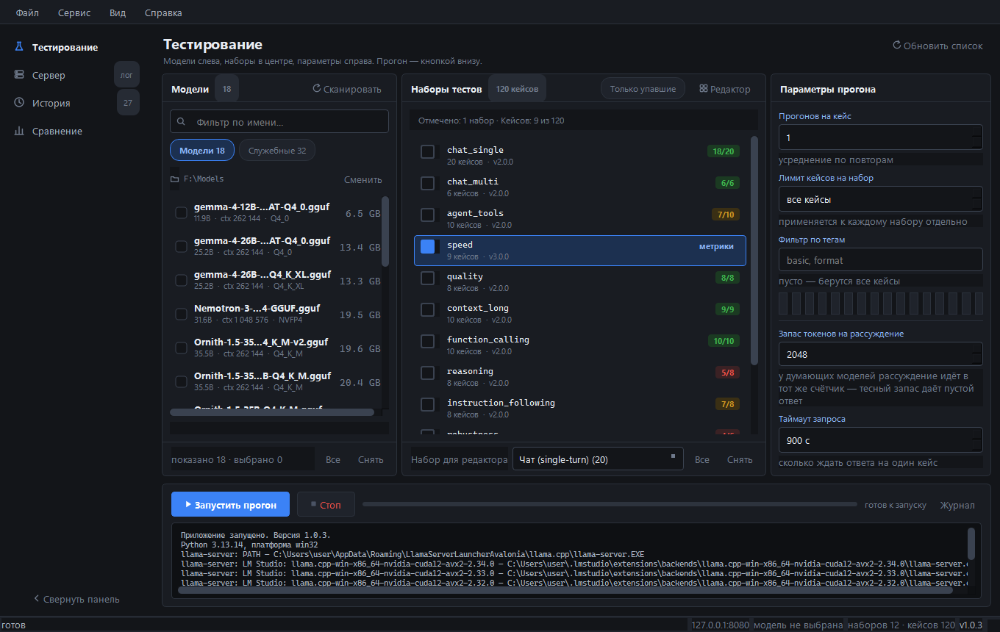

# LLM Test Bench

**Numbers, not vibes.** A test bench for local GGUF models on `llama.cpp`:
12 suites, 120 cases, prefill and generation speed, VRAM usage — all in one report.

[English](README.md) · [Русский](README.ru.md)




## What it is

You pick a model by feel: five questions in a chat window, "seems smart", done.
A week later it falls apart on four-step arithmetic — and you no longer remember
what the previous model answered to the same question.

This is a bench that turns that into numbers. It runs a fixed set of test cases
against the model you already have running, checks the answers automatically,
and keeps every run so you can compare models case by case.

- **Rule-based checks.** A judge model is called only where there is no way
  around it, so results do not depend on luck.
- **Quality and speed together.** Prefill and generation tok/s, TTFT, latency and
  VRAM sit in the same table as accuracy per suite.
- **Every failure in full.** Not "7 out of 10" but "here are the three cases that
  broke, here is the prompt, here is the answer, here is the check".

## How it works

The bench starts no server and loads nothing. Your launcher loads the model —
`llama.cpp`, LM Studio, your own script — and the bench tests whatever already
answers on `http://127.0.0.1:8080`. It does not touch your config.

## What's inside

12 suites, 120 cases. Each suite is a separate run, so you can pick one or run all.

| Suite | Cases | What it checks |
|---|---:|---|
| `chat_single` | 20 | single-turn questions: facts, format, JSON extraction, exact multiplication, an honest "no such thing" |
| `chat_multi` | 6 | context retention, memory through distractor questions, pressure toward a wrong answer, a rule from the first turn |
| `reasoning` | 8 | multi-step chains, order derived from constraints, traps with extra data, a task with no single answer |
| `instruction_following` | 8 | several constraints at once: length, format, order, prohibitions. Every condition is checked (`all_of`) |
| `robustness` | 6 | instruction hidden inside data, sycophancy, a non-existent method, incomplete and contradictory tasks, refusal |
| `code` | 5 | reading someone else's code: crash cause, slice output, complexity, a broken regex, a function from its description |
| `agent_tools` | 10 | choosing a tool and its arguments, two calls in one answer, an enum argument, and when *not* to call a tool |
| `function_calling` | 10 | JSON Schema validity: nested object, array, enum, optional argument, negation |
| `quality` | 8 | reference answers by key facts (judge stage) |
| `context_long` | 10 | needle in a haystack from 2K to 128K, two similar code blocks where only one is right, code at the edges, no code at all |
| `speed` | 9 | prefill from 100 to 32 000 tokens and long generation: tok/s, prefill tok/s, TTFT, total time |
| `russian` | 20 | Russian spelling by rules, morphology (cases, numerals, gender, stress), meaning and idioms, translation both ways, format discipline |

Checks are defined in `llmtestbench/checks.py`: `contains_any`, `contains_all`,
`not_contains`, `regex`, `exact_match`, `json_schema`, `tool_call`, `no_tool_call`,
`all_of`, `word_count`, `set_equal`. Deferred checks (`llm_judge`, `embedding`)
return "skipped", not "failed".

## Download

Windows 10/11. Free, MIT, no sign-up.

| | |
|---|---|
| **Installer** (MSI, 60 MB) | [LLMTestBench-1.0.3.msi](https://github.com/aleksandrreva-eng/llm-test-bench/releases/download/v1.0.3/LLMTestBench-1.0.3.msi) |
| **Portable** (single `.exe`) | [LLMTestBench.exe](https://github.com/aleksandrreva-eng/llm-test-bench/releases/download/v1.0.3/LLMTestBench.exe) |
| **User manual** (PDF, Russian) | [LLMTestBench-1.0.3-manual-ru.pdf](https://github.com/aleksandrreva-eng/llm-test-bench/releases/download/v1.0.3/LLMTestBench-1.0.3-manual-ru.pdf) |
| **All releases** | [releases](https://github.com/aleksandrreva-eng/llm-test-bench/releases) |

Python is **not** required for the installer or the portable build.

## Run from source

Python **3.13** (not 3.14 — PySide6 may have no wheels for it).

```bat
py -3.13 -m venv .venv
.venv\Scripts\python.exe -m pip install -r requirements.txt

:: check without the GUI: scan models and build the launch command
.venv\Scripts\python.exe main.py --selfcheck "F:\Models"

:: start the GUI
Запустить.bat
```

Run a suite from the console against an already running server:

```bat
Прогнать-тесты.bat chat_single --report
Прогнать-тесты.bat speed,chat_multi --runs 2 --report
Прогнать-тесты.bat chat_single --dry-run
```

## What you get

- **History** — one row per run, not per file. Expand it to see the cases, open a
  case card to see the prompt, the answer, the reasoning and the check breakdown.
- **Comparison** — runs as columns, metrics as rows, the best value marked. Expand
  a row to see which suite made the difference; double-click to compare case by
  case. A warning appears if the suite versions differ.
- **Reports** — HTML report per run, dark and light themes, CSV export.
- **Memory** — VRAM, RAM and mmap taken from the `llama-server` load log, not
  guessed. If the log has no data, the report says "no data" instead of zeros.

## Why another benchmark?

`lm-evaluation-harness` answers "how smart is this model in general", on academic
datasets. `llama-bench` measures speed and knows nothing about quality. Promptfoo
tests prompts inside an application and lives in CI.

This one answers a different question: **how does this particular quant behave on
your GPU, right now, on the tasks you care about** — and keeps the answer.

## Requirements

- Windows 10/11
- a running `llama-server` on `127.0.0.1:8080` (the app can also start one itself)
- for the memory block: the server started with `-v`, so the load log has the layer
  layout

## Links

- [Changelog](CHANGELOG.md)
- [User manual (RU)](docs/USER_MANUAL.md)
- Video: [Russian](https://youtu.be/0eJbCHqIhW0) · [English](https://youtu.be/Laa34Zas8gQ)
- Reviews and standards: [REVIEW_STANDARDS.md](REVIEW_STANDARDS.md)
- Support the project: [ЮMoney](https://yoomoney.ru/fundraise/1KJLC8PV82S.260929)

## License

MIT. Built by one person.
